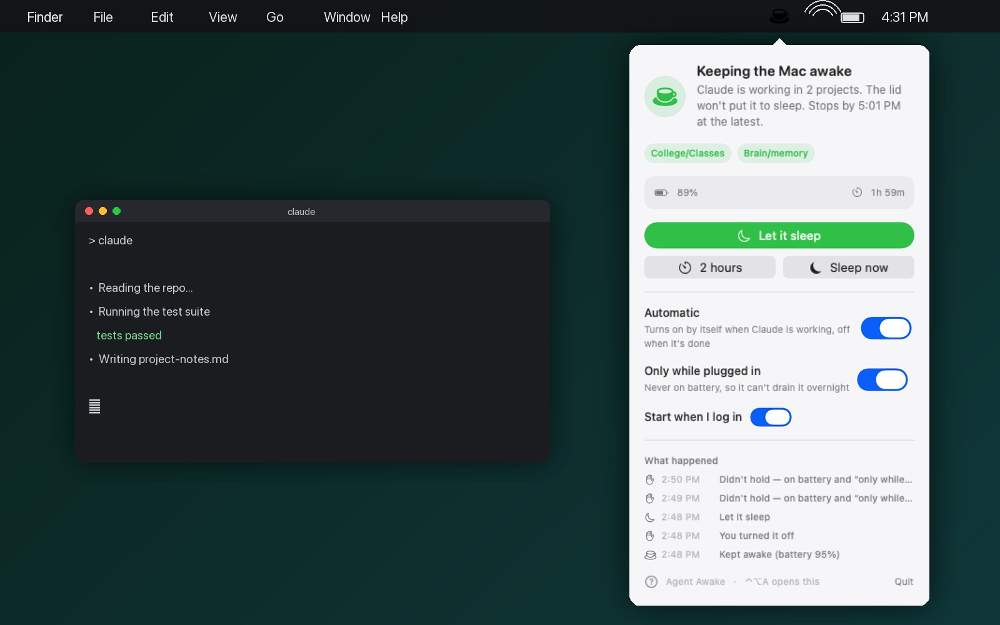

# Agent Awake

A menu-bar switch that keeps your Mac awake with the lid closed **while an AI agent is working**, lets it sleep normally the moment the agent finishes, and never fights you when *you* want it asleep.



Built because a Claude Code session kept dying when the laptop lid closed — and the tools that fix that (`pmset disablesleep`, Amphetamine's closed-display mode) also block *every* sleep, drain the battery to zero overnight, and leave the hold on after the work ends.

## The three rules

1. **Lid closed while the agent is working → stays awake.**
2. **Agent finishes → sleeps normally, within ~20 seconds.**
3. **You press sleep → it sleeps.** (Use *Sleep now* in the menu, `sleep-now`, or ⌃⌥A → Sleep now. The macOS primitive blocks the native Sleep menu item while a hold is on; this is the honest workaround.)

Plus the guard rails that the bad nights taught:

- **Only while plugged in** — on by default. On battery the Mac sleeps like a normal laptop.
- **Battery floors** — no new hold below 25% unplugged; at 10% unplugged it puts the Mac to sleep rather than letting it die.
- **Never orphaned** — the watcher that releases the hold runs in its own session; the app shows **⚠︎** if a hold ever has no watcher.
- **Automatic** is a real off switch, not a hidden one.

## Install

```bash
git clone https://github.com/a7ussein/agent-awake && cd agent-awake
./install.sh                 # engine + menu-bar app (built from source, so no Gatekeeper prompt)
./install.sh --claude-hooks  # also arm/release automatically around Claude Code turns
```

Requires macOS 13+ and the Xcode Command Line Tools (`xcode-select --install`). The installer asks for `sudo` once to write a single rule: the app may run `pmset -a disablesleep` without a password, and nothing else.

A prebuilt `Agent Awake.app` is attached to each release for people who don't want to build. It is unsigned: right-click → Open the first time.

## Using it

| in the menu | what it does |
|---|---|
| **Keep awake while Claude works** | holds; releases when no session is mid-turn, or after 10 idle minutes |
| **2 hours** | holds no matter what — only the time limit, the battery floors, or you release it |
| **Let it sleep** | releases |
| **Sleep now** | releases, then sleeps the Mac |
| **Automatic** | hold while the agent works, release when it finishes (needs the hooks) |
| **Only while plugged in** | on battery, behave like a normal laptop |
| **Start when I log in** | |
| **What happened** | the last five events in plain words — *why* it kept the Mac awake or let it sleep |
| **?** | a two-line explanation and the icon legend |
| **Using the battery** | the processes using real CPU right now (two `top` samples, not a lifetime average), described in plain words — what it is (API server, MCP server, dev server, VM…), the project folder it runs in, the ports it serves, and who started it (a script, a tmux session, a Claude Code session) — and a **Quit** that asks once then stops the process. Auto-expands when something is above 25%. Also names anything holding the Mac out of idle sleep, such as a `caffeinate`. |

Icon: ☕ keeping it awake · moon normal sleep · moon-zzz turned off · ⚠︎ something's stuck. **⌃⌥A** opens it from anywhere.

From a terminal: `agent-awake start [--minutes N] [--no-owner]`, `agent-awake stop`, `agent-awake status`, `agent-awake run -- <command>` (hold only while a command runs), `sleep-now`.

## How "agent finishes" is detected

With the Claude Code hooks installed, each session leaves a marker when a turn starts and removes it when the turn ends (Claude Code's `Stop` event). The hold releases when no markers remain. Several sessions can share the machine; the last one to finish releases. Markers older than two hours (a crashed session) are discarded, and no Claude process at all clears them.

Other agents: anything that can run a shell command can use `agent-awake run -- <your command>`, or touch/remove a file in `/tmp/agent-awake.active/` around its work.

## What it is honest about

- The only macOS mechanism that keeps a MacBook awake with the lid shut, `pmset disablesleep`, blocks the native Sleep menu item and the power button too. Every tool in this category hits that wall. *Sleep now* exists because of it.
- A loop that never finishes, on battery, is a dead battery by construction. "Only while plugged in" is on by default for that reason, and the 10% floor is the brake under it.
- A file another process writes during a session's turn is attributed to that turn. Seconds of exposure, not zero.

## Power

The app itself idles at about 0.1% CPU and spawns nothing while the popover is closed (a cheap status check every 30 s). CPU per process is read in-process from the kernel's task accounting, sampled twice 0.7 s apart — no `top`, no `lsof`, no `ps` per row — so measuring never shows up in its own list. Heavy work runs only while the popover is open, and the list you see on opening is the last background sample, taken before the opening animation, so the menu bar and WindowServer are not blamed for the redraw you just caused.

## Uninstall

`./uninstall.sh` — removes everything except the sudo rule, which it tells you how to remove.

## License

MIT © Automyte
